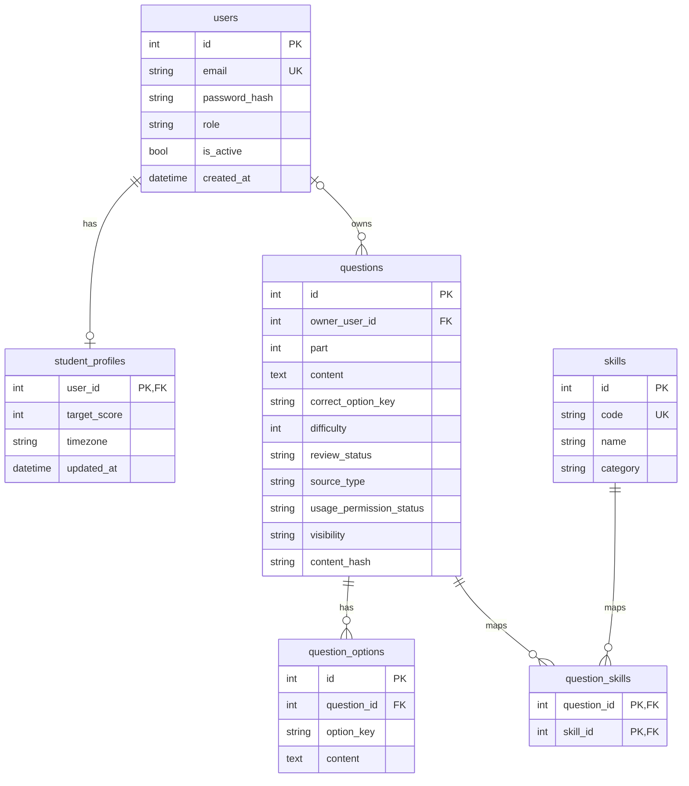

# DATABASE SCHEMA — TOEIC Tutor Agent

## 1. Mục đích

Thiết kế cơ sở dữ liệu cho hệ thống AI Agent
gia sư cá nhân hóa hỗ trợ luyện thi TOEIC.

Công nghệ:

- SQLite
- SQLAlchemy 2.x
- Alembic (cấu hình ở giai đoạn 02A.3)

Giai đoạn hiện tại: 02A.2

Phạm vi hiện tại: Core Models cho TOEIC Part 5.

## 2. Các bảng Core

| Bảng | Mục đích |
|---|---|
| users | Tài khoản và xác thực |
| student_profiles | Hồ sơ học tập |
| skills | Danh mục kỹ năng |
| questions | Ngân hàng câu hỏi |
| question_options | Các lựa chọn A/B/C/D |
| question_skills | Quan hệ N-N câu hỏi/kỹ năng |

## 3. ERD Core

## 4. Primary Keys và Foreign Keys

- users.id: Primary Key.
- student_profiles.user_id: PK và FK đến users.id.
- skills.id: Primary Key.
- questions.id: Primary Key.
- questions.owner_user_id: FK đến users.id, nullable.
- question_options.id: Primary Key.
- question_options.question_id: FK đến questions.id.
- question_skills.question_id: PK và FK đến questions.id.
- question_skills.skill_id: PK và FK đến skills.id.

SQLite foreign_keys phải được bật trên mỗi kết nối.

## 5. Unique Constraints

- users.email: UNIQUE, collation NOCASE.
- skills.code: UNIQUE.
- question_options: UNIQUE(question_id, option_key).
- question_skills: PK(question_id, skill_id).

content_hash có index nhưng chưa UNIQUE toàn cục.

## 6. CHECK Constraints

- users.role: student hoặc admin.
- skills.category: grammar, vocabulary, reading, other.
- questions.part: 5, 6 hoặc 7.
- questions.correct_option_key: A, B, C hoặc D.
- questions.difficulty: NULL hoặc 1 đến 5.
- questions.review_status:
  draft, pending_review, approved, rejected.
- questions.visibility: public hoặc private.
- Câu hỏi private phải có owner_user_id.
- Nội dung câu hỏi và lựa chọn không được rỗng.
- student_profiles.target_score:
  NULL hoặc 0 đến 990.

Phần mềm hiện chỉ triển khai nội dung Part 5.
Part 6–7 sẽ cần bổ sung passages và nghiệp vụ liên quan.

## 7. Index

- Unique index của email.
- Unique index của skills.code.
- ix_questions_part_review_status.
- ix_questions_owner_user_id.
- ix_questions_content_hash.
- ix_question_options_question_id.
- ix_question_skills_skill_id.

## 8. Quy tắc nghiệp vụ

1. LLM không tự quyết định đáp án chấm điểm chính thức.
2. Mỗi câu hỏi có một correct_option_key.
3. Trước khi duyệt, phải kiểm tra đủ bốn lựa chọn A/B/C/D.
4. Câu hỏi chưa duyệt không được tính mastery chính thức.
5. Câu hỏi AI sinh phải trải qua kiểm duyệt.
6. Cần kiểm tra quyền sử dụng nguồn tài liệu.
7. Dữ liệu cá nhân phải được kiểm soát theo chủ sở hữu.
8. Nội dung câu hỏi sau khi đưa vào phiên luyện tập
   phải được bảo toàn qua snapshot.
9. Không tự động sửa dữ liệu lịch sử đã chốt.
10. Việc chống trùng và phê duyệt sẽ thực hiện
    trong tầng service ở giai đoạn sau.

## 9. Quy ước thời gian

Các timestamp dùng quy ước UTC.

SQLite không tự lưu timezone offset trong DATETIME
mặc định. Tầng ứng dụng phải chuẩn hóa UTC
khi ghi và đọc thời gian.

## 10. Các bảng dự kiến bổ sung

### 02A.4

- quiz_sessions
- quiz_items
- attempts

### Student Modeling

- student_skill_mastery

### Adaptive Learning

- study_plans

### TOEIC Part 6–7

- passages

### Tutor Agent

- chat_sessions
- chat_messages

### RAG

- documents
- document_chunks

## 11. Chiến lược Migration

- 02A.2: Khai báo ORM và test độc lập.
- 02A.3: Cấu hình Alembic.
- Review migration được autogenerate.
- Chạy alembic upgrade sau khi xem xét.
- 02A.4: Bổ sung bảng Quiz bằng migration.

Không dùng Base.metadata.create_all()
để cập nhật database ứng dụng.

Base.metadata.create_all() chỉ được dùng
trong isolated in-memory unit tests của 02A.2.

## 12. Trạng thái

Thiết kế ERD tổng thể: Đã được người thực hiện duyệt.

Core Models: Đang triển khai.

Kiểm thử trên máy Windows: Chờ kết quả.

Alembic migration: Chưa bắt đầu.

---

## 13. Giai đoạn 02A.3 - Alembic Migrations

### Công nghệ

- SQLite
- SQLAlchemy 2.x
- Alembic
- Pytest

### Cấu hình

File cấu hình chính:
alembic.ini

Migration environment:
backend/alembic/env.py

Thư mục lưu revision:
backend/alembic/versions/

### Kết nối SQLAlchemy

Alembic sử dụng Base.metadata của SQLAlchemy.

Database URL được đọc từ cấu hình ứng dụng
trong backend/app/db/session.py.

SQLite foreign keys được bật trên mỗi kết nối.

### Initial Migration

Mục tiêu tạo 6 bảng:

1. users
2. student_profiles
3. skills
4. questions
5. question_options
6. question_skills

Alembic đồng thời quản lý bảng alembic_version.

### Nguyên tắc an toàn

- Review revision được autogenerate.
- Không chạy upgrade khi chưa xác nhận database đích.
- Không dùng Base.metadata.create_all() cho database ứng dụng.
- Không dùng alembic stamp để thay thế migration.
- Không chạy downgrade trên database chứa dữ liệu thật
  nếu chưa đánh giá ảnh hưởng và sao lưu.
- Kiểm thử migration bằng SQLite tạm.
- Không commit database SQLite hoặc dữ liệu cá nhân.

### Trạng thái

Đang triển khai 02A.3.

Chưa xác nhận initial migration đã được áp dụng.

---

## Giai đoạn 02A.4 - Quiz Database

### Các bảng mới

1. quiz_sessions
2. quiz_items
3. attempts

### Quan hệ

- users 1-N quiz_sessions
- quiz_sessions 1-N quiz_items
- questions 1-N quiz_items
- quiz_items 1-N attempts
- users 1-N attempts

### Quiz Sessions

Quản lý phiên luyện tập theo user_id.

Trạng thái:
- in_progress
- submitted
- abandoned

Index:
- (user_id, started_at)

### Quiz Items

Mỗi quiz_item liên kết với một câu hỏi gốc.

Lưu question_snapshot và answer_key_snapshot
để bảo toàn nội dung câu hỏi khi giao bài.

Ràng buộc:
- UNIQUE(quiz_session_id, position)
- UNIQUE(quiz_session_id, question_id)
- position >= 1
- answer_key_snapshot thuộc A, B, C, D

### Attempts

Lưu mỗi lần học viên nộp đáp án.

Ràng buộc:
- UNIQUE(quiz_item_id, attempt_number)
- attempt_number >= 1
- selected_option_key thuộc A, B, C, D
- time_spent_seconds >= 0 nếu có giá trị

is_correct được xác định bằng Python và answer key.

is_retry phải được tính từ lịch sử làm bài,
bao gồm cả các phiên luyện tập trước.

### Bảo toàn lịch sử và bảo mật

Các khóa ngoại liên quan đến lịch sử sử dụng
ON DELETE RESTRICT.

Không trả answer_key_snapshot trước khi nộp bài.

Tầng service phải kiểm tra quyền sở hữu,
tính đúng đắn của snapshot và tính bất biến
của dữ liệu đã chốt.

### Migration

Revision hiện tại: 96035621403c

02A.4.1: Khai báo ORM models, chưa migration.

02A.4.2: Tạo revision mới và review.
### 02A.4.2 - Quiz Migration

Revision ID: da7ab3c9873a

Previous revision: 96035621403c

Review: APPROVED

Temporary SQLite tests: PASSED

Application database upgrade: PENDING

New tables:
- quiz_sessions
- quiz_items
- attempts
02A.4.3: Upgrade và kiểm thử.
#### 02A.4.3 - SQLite Upgrade và Testing

Trạng thái: HOÀN THÀNH

- [x] Xác minh revision trước upgrade.
- [x] Xác minh migration head da7ab3c9873a.
- [x] Kiểm tra đường dẫn database.
- [x] Sao lưu database SQLite trước upgrade.
- [x] Chạy alembic upgrade head.
- [x] Xác minh revision da7ab3c9873a (head).
- [x] Kiểm tra đủ 10 bảng SQLite.
- [x] Xác minh PRAGMA foreign_keys = 1.
- [x] Xác minh PRAGMA integrity_check = ok.
- [x] Xác minh không có Foreign Key violations.
- [x] Tạo tests/db/test_quiz_constraints.py.
- [x] Chạy 9 Quiz Constraint Tests.
- [x] Chạy tổng hợp 24 Database Tests.
- [x] Xác nhận hoàn thành 02A.4.3.

### Kết quả

Database: data/toeic.sqlite3

Revision: da7ab3c9873a

Core Tables: 6
Quiz Tables: 3
Alembic Version Table: 1

Foreign Keys: ENABLED
Integrity Check: OK
Foreign Key Violations: 0

Pytest: 24 passed in 2.33s

### Backup

File:
data/toeic.backup-20261017-140342.sqlite3

Trạng thái:
Đã tạo trước khi áp dụng Quiz Migration.

### Bước tiếp theo

---
#### 02A.4.4 - Seed TOEIC Part 5

Trạng thái: HOÀN THÀNH TRIỂN KHAI VÀ KIỂM THỬ

- [x] Kiểm tra revision da7ab3c9873a.
- [ ] Xác minh backup trước seed.
- [x] Tạo scripts/__init__.py.
- [x] Tạo scripts/seed_toeic_part5.py.
- [x] Khai báo 5 kỹ năng TOEIC.
- [x] Khai báo 6 câu hỏi Part 5.
- [x] Triển khai kiểm tra dữ liệu trùng.
- [x] Triển khai rollback transaction.
- [x] Chạy 4 Seed Tests thành công.
- [x] Chạy 28 Database Tests thành công.
- [x] Chạy seed lần thứ nhất.
- [x] Chạy seed lần thứ hai.
- [x] Xác nhận không tạo bản ghi trùng.
- [x] Kiểm tra SQLite integrity.
- [x] Kiểm tra Foreign Key violations.
- [x] Xác nhận Alembic revision không thay đổi.

### Kết quả

Skills: 5
Questions: 6
Options: 24
Question-Skill Links: 7

Users: 0
Quiz Sessions: 0
Attempts: 0

Pytest: 28 passed in 6.15s

Seed lần 2:
Created skills: 0
Created questions: 0

Database Revision: da7ab3c9873a

Integrity: ok
Foreign Key Violations: 0

### Chính sách dữ liệu

Dữ liệu seed là câu hỏi minh họa do AI tạo.
Review status: draft.

Chưa sử dụng để đánh giá mastery chính thức.

### Bước tiếp theo

Hoàn thiện FastAPI nền tảng trước khi
triển khai 02B - Authentication.